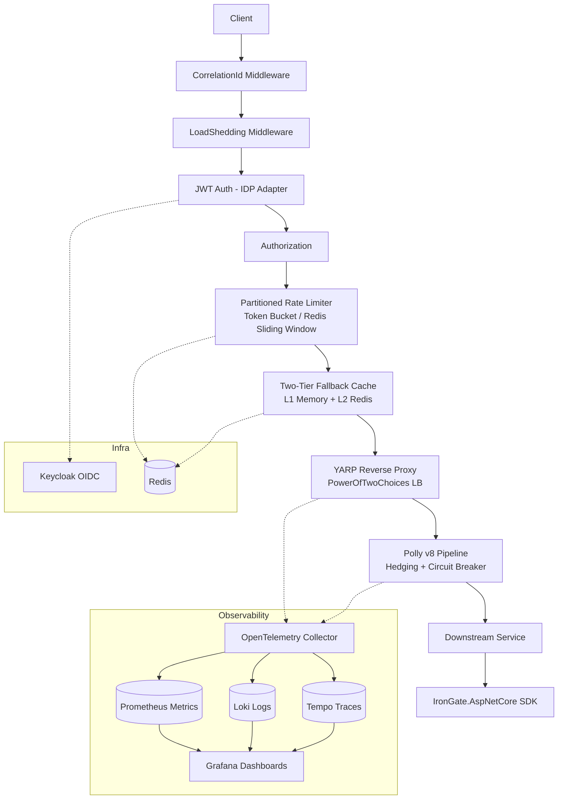

# IronGate

<p align="center">
  
  
  
  
  
</p>

**High-Performance Distributed L7 API Gateway & Traffic Controller built on .NET 10 & YARP**

IronGate is a production-ready API Gateway that handles authentication, rate limiting, resilience, observability, and graceful degradation — all in a single, containerized binary with a companion SDK for downstream services.

---

## Why IronGate?

| Feature | IronGate | Ocelot | NGINX | Kong | Envoy |
|---------|:--------:|:------:|:-----:|:----:|:-----:|
| **Throughput** | ~50k RPS | ~30k RPS | ~100k RPS | ~50k RPS | ~80k RPS |
| **Tail-Latency Hedging** | ✅ Polly v8 | ❌ | ❌ | ❌ | ❌ |
| **Graceful 5xx Fallback Caching** | ✅ L1/L2 Hybrid | ❌ | ❌ | ❌ | ❌ |
| **Distributed Rate Limiting** | ✅ Redis Lua | ❌ | ❌ | ✅ | ✅ |
| **Config Simplicity** | appsettings.json | JSON | conf | Declarative | xDS |
| **Companion Downstream SDK** | ✅ NuGet | ❌ | ❌ | ❌ | ❌ |
| **Zero-Trust Gateway Verification** | ✅ HMAC | ❌ | ❌ | ❌ | ❌ |
| **Admin Control Plane** | ✅ /admin/* | ❌ | ❌ | ✅ | ❌ |

---

## Architecture & Request Lifecycle



### Pipeline Order (Exact)

```
Client Request
    │
    ▼
┌─────────────────────────────────────────────────────────────────┐
│ 1. CorrelationIdMiddleware  ──► x-correlation-id header       │
├─────────────────────────────────────────────────────────────────┤
│ 2. LoadSheddingMiddleware ──► 503 if overloaded (priority bypass)│
├─────────────────────────────────────────────────────────────────┤
│ 3. JWT Authentication (IDP Adapter) ──► Keycloak / Auth0 / Entra│
├─────────────────────────────────────────────────────────────────┤
│ 4. Authorization (jwt-required / Anonymous)                    │
├─────────────────────────────────────────────────────────────────┤
│ 5. Partitioned Rate Limiter                                     │
│    ├─ /api/public/*  ──► Sliding Window by Client IP           │
│    └─ /api/protected/* ──► Token Bucket by JWT 'sub'           │
├─────────────────────────────────────────────────────────────────┤
│ 6. Two-Tier Fallback Cache                                      │
│    ├─ L1: In-Memory (30s TTL)                                   │
│    └─ L2: Redis (full TTL)                                     │
├─────────────────────────────────────────────────────────────────┤
│ 7. YARP Reverse Proxy (PowerOfTwoChoices)                      │
├─────────────────────────────────────────────────────────────────┤
│ 8. Polly v8 Resilience Pipeline                                 │
│    ├─ Speculative Hedging (idempotent only, 50ms delay)        │
│    ├─ Circuit Breaker (50% failure ratio, 15s break)           │
│    └─ Total Timeout (10s)                                      │
└─────────────────────────────────────────────────────────────────┘
    │
    ▼
Downstream Service (with IronGate.AspNetCore SDK)
```

---

## Core Features

### 1. Extensible IDP Adapter (Milestone 1)
- **Interface**: `IIdentityProvider` in `Domain/`
- **Built-in**: `KeycloakIdentityProvider` with realm_access/resource_access claim mapping
- **Pluggable**: Add `Auth0IdentityProvider`, `AzureAdIdentityProvider`, etc.
- **Config**: `IdentityProvider:Default = "keycloak"`

### 2. OpenTelemetry Observability (Milestone 2)
- **Traces**: Tempo via OTLP
- **Metrics**: Prometheus `/metrics` endpoint + `aspnetcore.rate_limiting.requests`, `resilience.polly.*`
- **Logs**: Loki via OTLP
- **Dashboards**: Grafana pre-configured

### 3. Partitioned Rate Limiting (Milestone 3)
| Route | Algorithm | Partition Key | Limits |
|-------|-----------|---------------|--------|
| `/api/public/*` | Sliding Window | Client IP | 10 req / 60s |
| `/api/protected/*` | Token Bucket | JWT `sub` | 20 tokens, refill 5/10s |
| **Headers** | | | `X-RateLimit-Limit`, `X-RateLimit-Remaining`, `X-RateLimit-Reset`, `Retry-After` |

### 4. Resilience Pipeline (Milestone 4)
| Feature | Config | Behavior |
|---------|--------|----------|
| **Speculative Hedging** | `DelayMs: 50`, `MaxHedgedAttempts: 2` | Idempotent-only, fires parallel request, fastest wins |
| **Circuit Breaker** | `FailureRatio: 0.5`, `BreakDuration: 15s` | Trips on 5xx/network errors, returns 503 with `X-IronGate-Circuit-State: Open` |
| **Total Timeout** | `10s` | Caps entire operation including hedged attempts |
| **Load Balancing** | `PowerOfTwoChoices` | Least-loaded destination selection |

### 5. Cached Static Fallback (Milestone 5)
| Tier | Source | TTL | Header |
|------|--------|-----|--------|
| **Tier 1** | In-Memory (L1) | 30s | `X-IronGate-Fallback-Source: cache` |
| **Tier 2** | Redis (L2) | 300s | `X-IronGate-Fallback-Source: cache` |
| **Tier 3** | Static Config JSON | ∞ | `X-IronGate-Fallback-Source: static-config` |
| **Trigger** | 5xx from downstream OR 503 from Circuit Breaker | | `X-IronGate-Fallback: true` |

### 6. Zero-Trust Gateway Verification (Task 1)
- **Gateway**: Injects `X-IronGate-Gateway-Secret` (HMAC) into downstream requests
- **SDK**: Validates via `CryptographicOperations.FixedTimeEquals` (timing-attack resistant)
- **Config**: `DownstreamSecurity:SharedSecret` in appsettings

### 7. Adaptive Load Shedding (Task 4)
- **Max Concurrent**: 500 (configurable)
- **Priority Bypass**: `X-IronGate-Priority: high` or admin roles → 110% capacity
- **Response**: `503 Service Unavailable`, `X-IronGate-Load-Shed: true`, `Retry-After: 5`
- **Metrics**: `irongate.load_shedding.rejected`, `irongate.requests.inflight`

### 8. Admin Control Plane (Task 5)
| Endpoint | Auth | Action |
|----------|------|--------|
| `GET /admin/status` | `X-IronGate-Admin-Key` | Routes, clusters, health, feature flags, in-flight count |
| `DELETE /admin/cache?path=...` | `X-IronGate-Admin-Key` | Evicts fallback cache entries |
| `DELETE /admin/ratelimit/{key}` | `X-IronGate-Admin-Key` | Resets rate limit quota |

---

## Custom HTTP Headers

| Header | Direction | Description |
|--------|-----------|-------------|
| `x-correlation-id` | Both | Request tracing across services |
| `X-IronGate-User-Id` | Downstream | JWT `sub` claim from gateway |
| `X-IronGate-Username` | Downstream | `preferred_username` claim |
| `X-IronGate-Roles` | Downstream | Comma-separated roles from token |
| `X-IronGate-Gateway-Secret` | Downstream | HMAC for zero-trust verification |
| `X-RateLimit-Limit` | Response | Max requests in window |
| `X-RateLimit-Remaining` | Response | Remaining requests |
| `X-RateLimit-Reset` | Response | Unix epoch when window resets |
| `Retry-After` | Response | Seconds until retry (429/503) |
| `X-IronGate-Hedged` | Response | `true` if hedging occurred |
| `X-IronGate-Attempts` | Response | Number of attempts (hedging) |
| `X-IronGate-Circuit-State` | Response | `Open` when circuit breaker tripped |
| `X-IronGate-Fallback` | Response | `true` if fallback served |
| `X-IronGate-Fallback-Source` | Response | `cache` \| `static-config` |
| `X-IronGate-Load-Shed` | Response | `true` if load shedding triggered |
| `X-IronGate-Priority` | Request | `high` for priority admission |

---

## Quickstart

### 1. Spin Up the Stack

```bash
# Clone and start
git clone https://github.com/suryan-s/IronGate
cd IronGate
docker compose up -d

# Wait for all services (check: docker compose ps)
# Keycloak: http://localhost:8080 (admin/admin)
# IronGate: http://localhost:8080
# Grafana:  http://localhost:3000 (admin/admin)
# Prometheus: http://localhost:9090
# Tempo:    http://localhost:3200
```

### 2. Get Keycloak Token

```bash
# Using irongate-test client
TOKEN=$(curl -s -X POST "http://localhost:8080/realms/master/protocol/openid-connect/token" \
  -H "Content-Type: application/x-www-form-urlencoded" \
  -d "username=admin" \
  -d "password=admin" \
  -d "grant_type=password" \
  -d "client_id=irongate-test" \
  -d "client_secret=test-secret" | jq -r '.access_token')
```

### 3. Test Public Route (Anonymous)

```bash
curl -i http://localhost:8080/api/public/echo
# 200 OK, x-correlation-id header present
```

### 4. Test Protected Route (Authenticated)

```bash
curl -i -H "Authorization: Bearer $TOKEN" http://localhost:8080/api/protected/echo
# 200 OK, X-IronGate-User-Id, X-IronGate-Username, X-IronGate-Roles headers
```

### 5. Trigger Rate Limiting

```bash
# Public: 10 req/min
for i in {1..12}; do curl -s -o /dev/null -w "%{http_code}\n" http://localhost:8080/api/public/echo; done
# 11th request → 429 with Retry-After, X-RateLimit-* headers

# Protected: 20 tokens, refill 5/10s
for i in {1..22}; do curl -s -o /dev/null -w "%{http_code}\n" -H "Authorization: Bearer $TOKEN" http://localhost:8080/api/protected/echo; done
# 21st request → 429
```

### 6. Test Admin API

```bash
# Configure Admin:ApiKey in appsettings.json first
curl -H "X-IronGate-Admin-Key: your-admin-key" http://localhost:8080/admin/status
```

### 7. Open Grafana

http://localhost:3000 (admin/admin) → Dashboards → IronGate

---

## Companion SDK: `IronGate.AspNetCore`

Downstream ASP.NET Core microservices install one NuGet package and get full auth context from IronGate headers — no Keycloak config needed!

### Install

```bash
dotnet add package IronGate.AspNetCore --source https://nuget.pkg.github.com/suryan-s/index.json
# or from GitHub Packages
```

### Configure

```csharp
// Program.cs
var builder = WebApplication.CreateBuilder(args);

builder.Services.AddIronGateDownstreamAuth(options =>
{
    options.RequireHeaders = true;           // Fail if X-IronGate-User-Id missing
    options.SharedSecret = "your-hmac-secret"; // Zero-trust verification (optional)
});

var app = builder.Build();

app.UseAuthentication();
app.UseAuthorization();
app.UseIronGateCorrelationId(); // Optional: extracts X-Correlation-Id

app.MapGet("/api/data", [Authorize] () => Results.Ok(new { data = "secret" }));
app.Run();
```

### What It Does

| Header | Becomes |
|--------|---------|
| `X-IronGate-User-Id` | `ClaimTypes.NameIdentifier` |
| `X-IronGate-Username` | `ClaimTypes.Name` |
| `X-IronGate-Roles` | `ClaimTypes.Role` (comma-separated) |
| `X-Correlation-Id` | `correlation_id` claim + `HttpContext.Items["CorrelationId"]` |
| `X-IronGate-Gateway-Secret` | Verified via `FixedTimeEquals` (if `SharedSecret` set) |

---

## Configuration Reference

### `appsettings.json` Sections

```json
{
  "IdentityProvider": { "Default": "keycloak" },
  "Keycloak": { "Authority": "http://keycloak:8080/realms/master", "Audience": "irongate-test" },
  "RateLimiting": {
    "Public": { "PermitLimit": 10, "WindowSeconds": 60, "SegmentsPerWindow": 6 },
    "Protected": { "TokenLimit": 20, "TokensPerPeriod": 5, "ReplenishmentPeriodSeconds": 10 },
    "Redis": { "Enabled": true, "ConnectionString": "redis:6379" }
  },
  "Resilience": {
    "Enabled": true,
    "Hedging": { "Enabled": true, "MaxHedgedAttempts": 2, "DelayMs": 50 },
    "CircuitBreaker": { "Enabled": true, "FailureRatio": 0.5, "MinimumThroughput": 5, "SamplingDurationSeconds": 10, "BreakDurationSeconds": 15 },
    "TotalRequestTimeoutSeconds": 10
  },
  "FallbackCache": {
    "Enabled": true,
    "TtlSeconds": 300,
    "StaticFallbacks": { "/api/public/echo": "{\"status\":\"degraded\"}" },
    "UseRedis": true
  },
  "LoadShedding": { "Enabled": true, "MaxConcurrentRequests": 500, "QueueLimit": 0 },
  "Admin": { "ApiKey": "your-secure-admin-key" },
  "DownstreamSecurity": { "SharedSecret": "your-hmac-secret" }
}
```

### Environment Variables (Docker)

All config values can be overridden via env vars:
```
RateLimiting__Redis__ConnectionString=redis:6379
RateLimiting__Redis__Enabled=true
Resilience__CircuitBreaker__FailureRatio=0.5
FallbackCache__UseRedis=true
DownstreamSecurity__SharedSecret=your-secret
Admin__ApiKey=your-admin-key
```

---

## Admin API Endpoints

| Method | Path | Description |
|--------|------|-------------|
| `GET` | `/admin/status` | Full gateway status (routes, clusters, health, flags, in-flight count) |
| `DELETE` | `/admin/cache?path=/api/public/echo` | Evict fallback cache for path (or all if omitted) |
| `DELETE` | `/admin/ratelimit/public:192.168.1.1` | Reset rate limit for partition key |

All require `X-IronGate-Admin-Key` header matching `Admin:ApiKey`.

---

## Benchmarking

```bash
# From repo root
cd benchmarks

# Throughput & Rate Limiting
docker run -i --rm --network=irongate-network \
  -e IRONGATE_URL=http://irongate:8080 \
  -e KEYCLOAK_TOKEN=$TOKEN \
  grafana/k6 run - < k6-throughput-and-ratelimit.js

# Chaos Fallback (manual: kill echo container during chaos phase)
docker run -i --rm --network=irongate-network \
  -e IRONGATE_URL=http://irongate:8080 \
  grafana/k6 run - < k6-chaos-fallback.js
```

See [benchmarks/README.md](benchmarks/README.md) for full details.

---

## Release Pipeline

Automated on version tags (`v*.*.*`):

1. **Test** → `dotnet test -c Release`
2. **Docker** → Multi-tag push to `ghcr.io/suryan-s/irongate:<tag>` + `:latest`
3. **NuGet** → Pack & push `IronGate.AspNetCore` to GitHub Packages

```bash
git tag v1.0.0
git push origin v1.0.0
# Triggers .github/workflows/release.yml
```

---

## Contributing

1. Fork & create feature branch
2. Implement with tests (`dotnet test`)
4. Ensure `dotnet build -c Release` passes
5. Open PR

---

## License

MIT License — see [LICENSE](LICENSE) for details.

---

<p align="center">
  <strong>Built with ❤️ on .NET 10, YARP, Polly v8, and OpenTelemetry</strong>
</p>